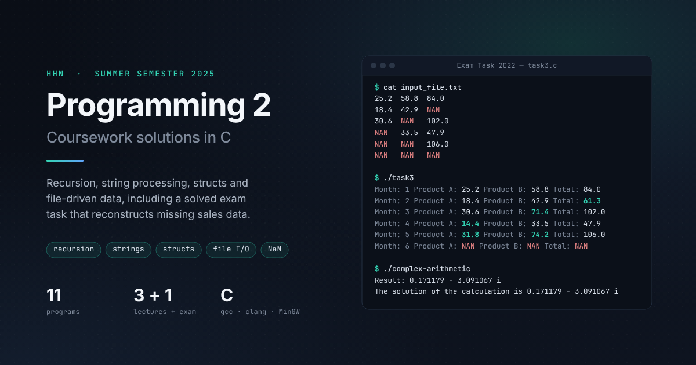
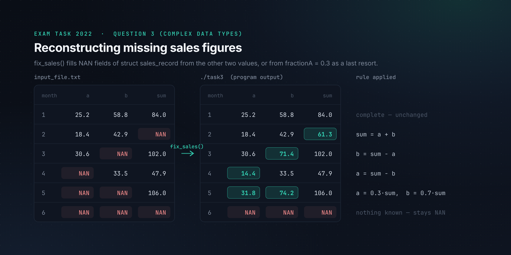
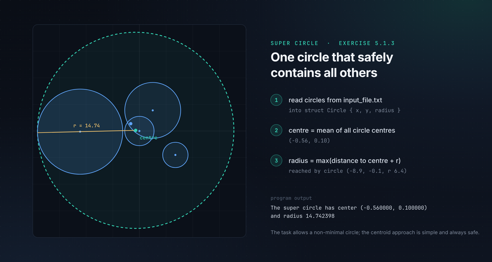
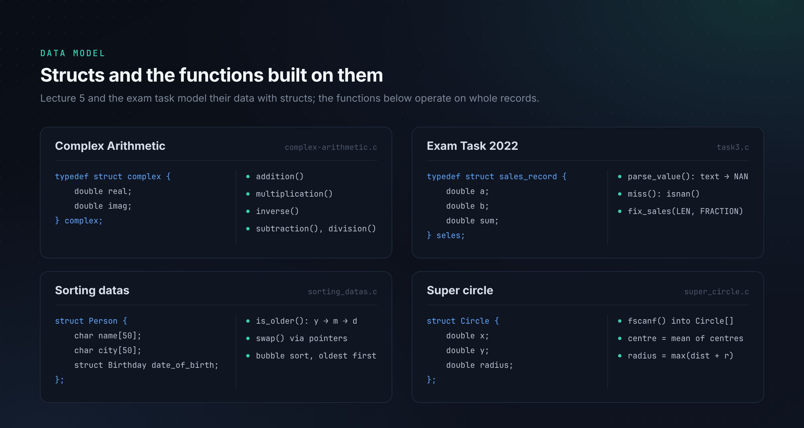
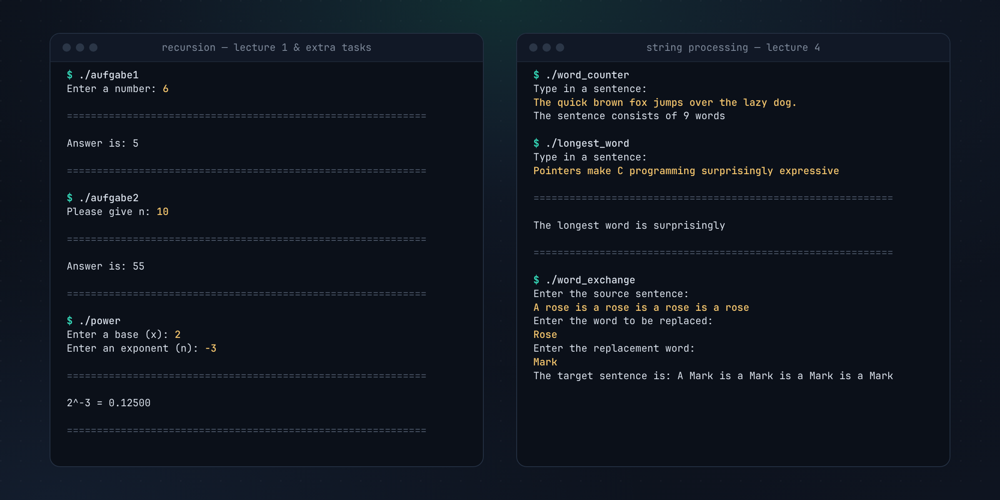

# HHN-SS25: Programming 2 in C



Solutions to the C programming exercises of the summer semester 2025 at Hochschule Heilbronn (HHN): recursion, string
processing with `strtok`, structs, file input, and a solved exam task that reconstructs missing data from `NAN` values.

## Overview

The repository collects one standalone C program per exercise from the lecture slides of Prof. Dr. Ipek Saraç Heinz.
Each folder holds the source code, a Windows build and screenshots of the code and, for the lecture exercises, of the
original task. The semester continues the introductory course documented in [HHN-WS24](https://github.com/soobshoob/HHN-WS24) and moves
from single values to composite data:

- **Lecture 1: recursion.** A recursive power function that also handles negative exponents.
- **Lecture 4: strings.** Tokenising sentences, finding the longest word, replacing words case-insensitively.
- **Lecture 5: structs and files.** Records read from text files, then searched, sorted and combined geometrically;
  complex numbers as a struct type.
- **Exam task.** Question 3 of the *Programming 2* exam of 12 July 2022 (complex data types, 40 points).
- **Two extra tasks** on recursive functions.

## Technologies

| | |
|---|---|
| Language | C (C99 and later: `//` comments, declarations in `for`, `typedef struct`) |
| Standard library | `stdio.h`, `string.h` (`strtok`, `strcmp`, `strcspn`; `strcasecmp` from POSIX), `math.h` (`sqrt`, `isnan`, `NAN`), `stdlib.h` (`atof`) |
| Compilers | GCC 13 and Clang on Linux; the `.exe` files were built with MinGW GCC 6.3.0 (32-bit Windows) |
| Input | `stdin` via `scanf`/`fgets`; text files via `fopen`, `fscanf`, `fgets` + `sscanf` |

## Highlights

### Exam task 2022: reconstructing missing sales data

`struct sales_record` holds the monthly revenue of product A, product B and their sum; a "database error" replaced some
of the values with `NAN`. `fix_sales()` checks every combination of missing fields with `isnan()` and derives the missing
values from the known ones. When only one value is known, it falls back to `fractionA = 0.3`, the average share of
product A. A record with no known value stays `NAN`. The output matches the exam's reference solution line for line.



### Super circle

The program reads five circles from `input_file.txt` and computes a circle that contains all of them. The centre is the
mean of all centres; the radius is the largest `distance + radius` over all circles. The task explicitly allows a
non-minimal result, so this simple construction is valid. It gives a different (larger) circle than the example on the
task sheet, which uses another construction.



### Structs as the data model

Lecture 5 and the exam task model their data with structs and pass whole records to functions. Sorting nests
`struct Birthday` inside `struct Person` and compares year, then month, then day. Complex arithmetic implements only
addition, multiplication and the inverse, and expresses subtraction and division through them, as the task requires.



## Exercises

| Lecture | Exercise | Folder | What the program does |
|---|---|---|---|
| 1 | 1.1.1 | [Power](Power/) | `x^n` by recursion, including negative exponents (`1 / x^-n`) |
| 4 | 4.1.1 | [Word counter](Word%20counter/) | Counts words with `strtok` over whitespace and punctuation |
| 4 | 4.1.2 | [The longest word](The%20longest%20word/) | Finds the longest token in a sentence |
| 4 | 4.1.3 | [Word exchange](Word%20exchange/) | Replaces every occurrence of a word, case-insensitively (`strcasecmp`) |
| 5 | 5.1.1 | [Search of person](Search%20of%20person/) | Loads `name year city` records from a file and looks a name up |
| 5 | 5.1.2 | [Sorting datas](Sorting%20datas/) | Sorts person records by date of birth, oldest first (bubble sort) |
| 5 | 5.1.3 | [Super circle](Super%20circle/) | Encloses all circles from a file in one circle |
| 5 | 5.1.4 | [Complex Arithmetic](Complex%20Arithmetic/) | Complex numbers as a struct; evaluates `val[4] − val[3] / (val[2] · (val[0] + val[1]))` |
| Exam | 2022, Q3 | [Exam Task 2022 (Complex datatypes)](Exam%20Task%202022%20%28Complex%20datatypes%29/) | Reconstructs missing sales values (see above) |
| Extra | 1 | [Aufgabe 1 (Extra)](Aufgabe%201%20%28Extra%29/) | Recursive `f(n)`: halves `n`, adds 1 for even and 2 for odd steps (= bit length + number of 1-bits) |
| Extra | 2 | [Aufgabe 2 (Extra)](Aufgabe%202%20%28Extra%29/) | Recursive Fibonacci, `f(1) = f(2) = 1` |

Exercise numbers come from the lecture slides, so `Ctrl+F` for e.g. "5.1.3" finds the matching task.

## Project structure

```text
HHN-SS25/
├── <Exercise name>/
│   ├── <program>.c            solution source
│   ├── <program>.exe          Windows build (MinGW, 32-bit)
│   ├── input_file.txt         input data, for the programs that read a file
│   ├── screenshot_task.png    original task from the lecture slides (exam: three pages)
│   ├── screenshot_code.png    screenshot of the solution code
│   └── Screenshot_result.png  terminal output (some exercises)
├── docs/assets/               README images; source/ holds their SVG sources
└── scripts/build.sh           builds every program into build/
```

Screenshot names differ slightly between folders (`screenshot_task.png`, `screenshot-task.png`, `Screenshot_task.png`).

## Build and run

Requirements: a C compiler (GCC or Clang) and the maths library. On Windows, use the included `.exe` files, or build
under WSL or MSYS2.

Build all programs into `build/` (ignored by Git):

```bash
sh scripts/build.sh
```

The script uses `cc` by default. To pick a compiler, set `CC`:

```bash
CC=clang sh scripts/build.sh
```

Build a single program:

```bash
gcc "Power/power.c" -o power -lm
```

The programs that read data open `input_file.txt` in the **current directory**, so run them from their own folder:

```bash
cd "Exam Task 2022 (Complex datatypes)" && ../build/task3
```

On Windows, start the prebuilt executable from its folder the same way, for example `super_circle.exe` inside
`Super circle`.

## Usage examples

The transcripts below are real runs of the programs built with `scripts/build.sh`; typed input is shown after the prompts.

```text
$ cd "Sorting datas" && ../build/sorting_datas

============================================================

02.04.1958: Anton, Hamburg
03.08.1964: Meike, Oldenburg
01.10.1964: Marc, Stuttgart
21.10.1964: Tina, Berlin
20.07.1976: Andreas, Mainz
02.09.1992: Karina, Muenchen

============================================================
```

```text
$ ./build/complex-arithmetic
Result: 0.171179 - 3.091067 i
The solution of the calculation is 0.171179 - 3.091067 i
```

```text
$ ./build/word_exchange
Enter the source sentence:
A rose is a rose is a rose is a rose
Enter the word to be replaced:
Rose
Enter the replacement word:
Mark
The target sentence is: A Mark is a Mark is a Mark is a Mark
```

More runs, covering the recursion exercises and the string programs:



## Technical challenges and learning outcomes

- **Missing values as data.** The exam task uses IEEE 754 `NAN` as a "missing" marker. `parse_value()` maps the text
  `NAN` to the `NAN` macro, and `isnan()` drives a case analysis over the three fields.
- **Recursion with a clear base case.** `functional(x, n)` in `power.c` reduces negative exponents to positive ones. Aufgabe 1 shows that a
  recursion over `n / 2` computes a property of the binary representation.
- **Destructive tokenising.** `strtok` writes `\0` into the buffer it splits. The word-count and longest-word programs
  rely on this behaviour; in Word exchange it means punctuation after a token cannot be read back, so the output sentence
  loses its punctuation (`I like cats. Cats are great!` with `cats` → `dogs` becomes `I like dogs dogs are great`).
- **Records from files.** `fscanf` reads straight into struct fields until the format no longer matches; Sorting datas
  and Super circle also stop at the array capacity (`MAX_PEOPLE`, `MAX_AMOUNT`).
- **Multi-key comparison.** `is_older()` compares year, month and day in order. Bubble sort with a `swap()` through
  pointers moves whole structs. The result has the same order as the task's example output; dates are printed
  zero-padded (`02.04.1958`).

Known limitations, kept as submitted:

- Aufgabe 2 is the naive recursive Fibonacci with exponential running time; `n = 50` does not finish within seconds.
- Super circle divides by the number of circles without checking that the file contained any.

## Source

The exercises come from the lecture presentations of Prof. Dr. Ipek Saraç Heinz, Hochschule Heilbronn. This repository
is meant for personal learning, reference and practice.
